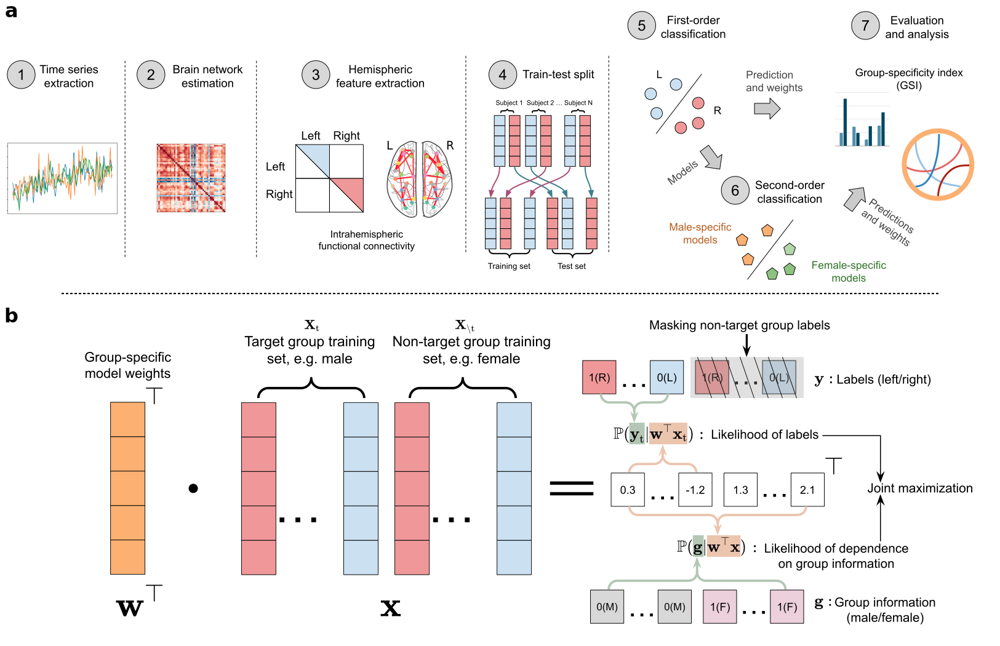

# Group-specific discriminant analysis

[](https://colab.research.google.com/github/shuo-zhou/GSDA-Lateralization/blob/main/gsda_demo.ipynb)
[](https://github.com/shuo-zhou/GSDA-Lateralization/blob/main/README.md)
[](https://doi.org/10.1093/gigascience/giaf082)
[](https://zenodo.org/doi/10.5281/zenodo.13626594)

## Introduction

This repository contains the experiments from the GigaScience paper [Group-specific discriminant analysis enhances detection of sex differences in brain functional network lateralization](https://doi.org/10.1093/gigascience/giaf082) by Zhou et al. (2025).

The Group-specific discriminant analysis (GSDA) algorithm is implemented in the [kalelinear](https://github.com/pykale/linear) package. The code used here is [`kalelinear.estimator.GSDA`](https://github.com/pykale/linear/blob/0.1.0b1/kalelinear/estimator/_gsda.py) (`kalelinear==0.1.0b1`).

## Framework



## Datasets

The resting-state fMRI data from [HCP](https://www.humanconnectome.org) [[1](#references)] and [GSP](https://www.neuroinfo.org/gsp/) [[2](#references)] is used in this study. Code for data preprocessing is available at `/preprocess`. Processed data is available at Zenodo: [[HCP](https://doi.org/10.5281/zenodo.10050233)], [[GSP](https://doi.org/10.5281/zenodo.10050234)].

## System Requirements

```(text)
numpy>=1.24.3
pandas>=1.5.3
scipy>=1.10.1
scikit-learn>=1.2.2
pytorch>=2.0.0
yacs
kalelinear==0.1.0b1
```

## Installation Guide

```(bash)
pip install -r requirements.txt
```

The GSDA implementation comes from [kalelinear](https://pypi.org/project/kalelinear/), which is currently a pre-release and is installed by the command above. To install it on its own, use `pip install --pre kalelinear==0.1.0b1`.

## Implementation

GSDA lives in [`kalelinear/estimator/_gsda.py`](https://github.com/pykale/linear/blob/0.1.0b1/kalelinear/estimator/_gsda.py), and this repository calls it from `utils/experiment.py`:

```(python)
from kalelinear.estimator import GSDA

model = GSDA(lr=..., max_iter=..., l2_hparam=..., lambda_=..., optimizer=...)
model.fit(x_train, y=y, groups=groups, target_idx=target_idx)
```

`lambda_` weights the HSIC term that controls the impact of group (sex) information on the learned weights, and `lambda_=0` gives the plain logistic regression baseline used in the paper.

### Reproducing the paper results

The results in the paper were produced with the original in-repository implementation (`semistats`), which was moved to `kalelinear` after publication. To run that exact code, use the [v1.0.0 release](https://github.com/shuo-zhou/GSDA-Lateralization/releases/tag/v1.0.0).

## Instructions for Use

Basic usage:

```(bash)
python main.py --cfg configs/demo-hcp.yaml
```

Please create more .yaml files for different random seeds and datasets.

## Demo

We provide GSDA running demo through a cloud Jupyter notebook on [](https://colab.research.google.com/github/shuo-zhou/GSDA-Lateralization/blob/main/gsda_demo.ipynb). Note the number of repetition is limited for faster demonstrations. This demo takes 10-20 minutes to complete the training and testing process.

## References

[1] Smith, S. M. et al. [Resting-state fMRI in the human connectome project](https://www.sciencedirect.com/science/article/abs/pii/S1053811913005338). _NeuroImage_ 80, 144–168 (2013)

[2] Holmes, A. J. et al. [Brain genomics superstruct project initial data release with structural, functional, and behavioral measures](https://www.nature.com/articles/sdata201531). _Sci. Data_ 2, 1–16 (2015)

## Citation

If you use this code in your research, please cite the following paper:

```(text)
@article{10.1093/gigascience/giaf082,
    author = {Zhou, Shuo and Luo, Junhao and Jiang, Yaya and Wang, Haolin and Lu, Haiping and Gong, Gaolang},
    title = {Group-specific discriminant analysis enhances detection of sex differences in brain functional network lateralization},
    journal = {GigaScience},
    volume = {14},
    pages = {giaf082},
    year = {2025},
    month = {08},
    issn = {2047-217X},
    doi = {10.1093/gigascience/giaf082},
    publisher={Oxford University Press}
}
```
